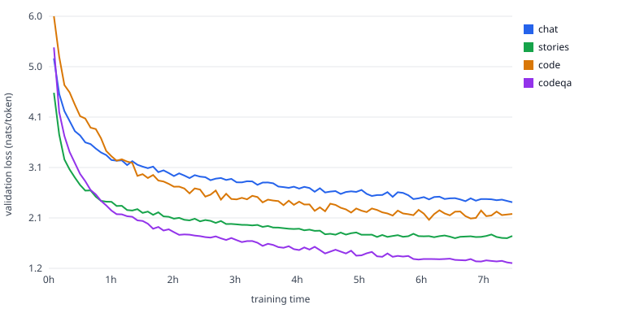

<h1 align="center">Kadmos-1</h1>

<p align="center"><b>A small conversational language model, written and trained from scratch on a single laptop.</b><br>
45.8 million parameters. Chats in plain English and writes short Python. Trained overnight on an Apple M2 Pro.</p>

<p align="center">
  <a href="https://github.com/adswill/kadmos-1/releases/latest"></a>
  <a href="https://github.com/adswill/kadmos-1/stargazers"></a>
  
  
  
  <a href="LICENSE"></a>
  <a href="https://ko-fi.com/adswill"></a>
</p>

<p align="center">
  <a href="#quick-start"><b>Quick start</b></a> &nbsp;·&nbsp;
  <a href="#results"><b>Results</b></a> &nbsp;·&nbsp;
  <a href="#how-it-was-built"><b>How it was built</b></a> &nbsp;·&nbsp;
  <a href="#limitations"><b>Limitations</b></a> &nbsp;·&nbsp;
  <a href="https://github.com/adswill/kadmos-1/releases/latest"><b>Download weights</b></a>
</p>

<p align="center"><a href="https://ko-fi.com/adswill"></a></p>

---

Kadmos-1 is a decoder-only transformer language model whose architecture, tokenizer, training loop and weights were all produced in this repository. No pretrained model was used as a starting point, and nothing was distilled from another model. It starts from random numbers and learns everything from the text listed in [Training data](#training-data).

The goal was to see how far a single consumer laptop can get in one night. The answer is a model that holds a short, friendly conversation, answers simple questions, and writes small Python functions, while making plenty of mistakes. It is small enough to read end to end: the model is about 110 lines and the trainer about 180.

The name is from Kadmos (Cadmus), the figure in Greek myth who brought the alphabet to Greece.

> [!NOTE]
> Kadmos-1 is a research and learning project, not a general assistant. At this size it often answers the wrong question, invents facts, and produces code that does not run. See [Limitations](#limitations).

## Contents

- [Quick start](#quick-start)
- [Results](#results)
- [Example conversations](#example-conversations)
- [How it was built](#how-it-was-built) · [Model](#model) · [Training data](#training-data) · [Training recipe](#training-recipe)
- [Project layout](#project-layout)
- [Limitations](#limitations)
- [Support](#support)
- [License](#license) · [Credits](#credits)

## Quick start

Kadmos-1 runs on any machine with PyTorch. On Apple Silicon it uses the GPU through Metal (MPS); elsewhere it falls back to the CPU.

```bash
git clone https://github.com/adswill/kadmos-1.git
cd kadmos-1
python3 -m venv .venv && source .venv/bin/activate
pip install -r requirements.txt
```

Download `kadmos-1.pt` (about 108 MB) from the [latest release](https://github.com/adswill/kadmos-1/releases/latest) into the repository folder, then start a chat:

```bash
python chat.py kadmos-1.pt
```

| Command | What it does |
|---|---|
| `reset` | Clear the conversation memory |
| `/temp 0.5` | Set the sampling temperature (lower is more predictable, default 0.7) |
| `/len 300` | Set the maximum reply length in tokens (default 200) |
| `quit` | Exit |

Kadmos-1 remembers the most recent turns of the conversation, up to its 512-token context window.

## Results

The released checkpoint is from step 6,906 of 6,940, the point with the lowest conversation validation loss. Perplexity is the exponential of the loss; it is roughly the number of tokens the model is choosing between at each step.

| Held-out text | Validation loss | Perplexity | At the first evaluation (5 minutes in) |
|---|---|---|---|
| Conversation | 2.44 | 11.5 | 5.19 |
| Code Q&A (request and Python answer) | 1.28 | 3.6 | 5.40 |
| Stories | 1.79 | 6.0 | 4.54 |
| Python files | 2.22 | 9.2 | 6.18 |

A model that guessed uniformly among the 16,384 tokens would score 9.70. Python code Q&A is the easiest to predict because answers are formulaic (a `def` line, an indented body, a `return`); open-ended conversation is the hardest because many replies are plausible.

<p align="center"></p>

Validation loss is cross-entropy in nats per token on held-out text from each source, measured with the Kadmos-1 tokenizer. Lower is better. The held-out sets are separate from the training data: stories and Python files are held-out documents, conversations come from each dataset's own validation split.

## Example conversations

These are unedited transcripts from the released weights at temperature 0.7. They were not chosen to look good; see [Limitations](#limitations) for what to expect.

**Small talk**

```
you: Hello! What is your name?
bot: My name is John.
you: Nice to meet you. What do you like to do on weekends?
bot: I like to play sports and listen to music.
you: That sounds fun. I usually just relax at home.
bot: Yeah, it's a good way to stay in shape.
```

**Advice**

```
you: Can you give me some advice? I have a job interview tomorrow.
bot: I would be happy to help. It's important to get some experience in your field, and I know a lot about what kinds of jobs you have, so I'd love to hear more about that.
you: I am a little nervous.
bot: I am a little nervous, but I think I can be helpful.
```

**Python**

````
you: Write a Python function that reverses a string.
bot: ```python
def reverseString(str):
    return str[::-1]

# Example
string = "Hello World"
print(reverseString(string)) # Output: Hello
```

you: Write a Python function to check if a number is prime.
bot: ```python
def is_prime(num):
    if num == 1:
        return False
    for i in range(2, num):
        if (num % i == 0):
            return False
    return True
```

you: Write a function that returns the sum of a list of numbers.
bot: ```python
def sum_list(nums):
    # Initialize a counter variable to store the sum
    total = 0

    # Iterate over the numbers from 1 to the given target number
    for num in nums:
        total += num

    return total

# Test the function
nums = [1, 2, 3, 4, 5]
print(sum_list(nums)) # 9
```
````

All three functions run. The string reversal and the prime check are correct, and the prime check is slow but right for a first attempt. The sum function is correct, but its comments are wrong (it says "from 1 to the given target number") and it claims the sum of 1 to 5 is 9.

**Where it fails**

```
you: What is the capital of France?
bot: The capital of France is Mars, but it's the largest country in the world.
you: Tell me a short story about a dog.
bot: Well, the capital of France is Mars.
```

It does not know facts, and it can get stuck on an earlier topic in the same conversation (type `reset` to clear it). Its replies to advice requests sound like advice without containing any.

## How it was built

### Model

A Llama-style decoder, written from scratch in PyTorch ([model.py](model.py)).

| | |
|---|---|
| Parameters | 45.8 M (of which 8.4 M are the tied token embedding) |
| Layers | 12 |
| Hidden size | 512 |
| Attention heads | 8 (head size 64) |
| Feed-forward | SwiGLU, hidden size 1344 |
| Normalisation | RMSNorm, applied before each sub-layer |
| Positions | Rotary position embeddings (RoPE) |
| Context length | 512 tokens |
| Vocabulary | 16,384 byte-level BPE tokens, trained on the corpus below |
| Other | No biases, tied input and output embeddings, dropout 0.05 |

Conversations are written with explicit turn tokens, so replies can contain several lines of text or code:

````
<|user|>Write a Python function that reverses a string.<|end|><|bot|>```python
def reverse(s):
    return s[::-1]
```<|end|>
````

### Training data

Every token the model saw comes from the public datasets below. 265 million tokens were available; the run sampled from them according to the recipe in the next section.

| Bucket | Source | Used | Tokens |
|---|---|---|---|
| Stories | [TinyStories](https://huggingface.co/datasets/roneneldan/TinyStories) | first 600,000 stories | 129.1 M |
| Python | [codeparrot-clean](https://huggingface.co/datasets/codeparrot/codeparrot-clean) | 80,000 files of 300 to 8,000 characters | 77.0 M |
| Conversation | [DailyDialog](https://huggingface.co/datasets/roskoN/dailydialog), [EmpatheticDialogues](https://huggingface.co/datasets/facebook/empathetic_dialogues), [SODA](https://huggingface.co/datasets/allenai/soda) (first 200,000), [OpenAssistant oasst1](https://huggingface.co/datasets/OpenAssistant/oasst1) (short English threads), [Anthropic HH helpful-*](https://huggingface.co/datasets/Anthropic/hh-rlhf) (chosen replies), [Everyday Conversations](https://huggingface.co/datasets/HuggingFaceTB/everyday-conversations-llama3.1-2k) | 312,066 conversations | 51.8 M |
| Code Q&A | [Python code instructions 18k](https://huggingface.co/datasets/iamtarun/python_code_instructions_18k_alpaca), [CodeAlpaca-20k](https://huggingface.co/datasets/sahil2801/CodeAlpaca-20k), [python-codes-25k](https://huggingface.co/datasets/flytech/python-codes-25k) | 60,901 request and answer pairs, deduplicated | 7.5 M |

A few of these datasets (SODA, Everyday Conversations and several of the code instruction sets) were themselves generated by other language models. Kadmos-1 is trained from scratch, but it learns from that text, and some of the style of the earlier models comes through with it. Licences for every dataset are listed in [DATA.md](DATA.md).

### Training recipe

| | |
|---|---|
| Hardware | One Apple M2 Pro laptop, 16 GB, training on the GPU through MPS |
| Duration | 7.5 hours of wall-clock time, 6,940 optimiser steps |
| Tokens seen | 227 million |
| Batch | 32,768 tokens per step (16 sequences, 4 accumulation steps, 512 tokens) |
| Optimiser | AdamW, betas (0.9, 0.95), weight decay 0.1 on weight matrices |
| Learning rate | Peak 1e-3, 150 warm-up steps, cosine decay to 5% over the time budget |
| Precision | float32 (bfloat16 was slower on this chip), `torch.compile` for about 28% more speed |
| Stage 1 (first 80% of time) | 25% stories, 15% Python, 10% code Q&A, 50% conversation |
| Stage 2 (last 20% of time) | 5% stories, 5% Python, 15% code Q&A, 75% conversation |
| Checkpoint kept | The one with the lowest conversation validation loss |

The schedule is driven by wall-clock time rather than step count, so the run finishes on schedule whatever the speed of the machine.
## Project layout

| File | Purpose |
|---|---|
| [model.py](model.py) | The transformer: RMSNorm, RoPE, SwiGLU, attention, sampling |
| [train.py](train.py) | Time-budgeted, resumable trainer with evaluation, samples and checkpoints |
| [chat.py](chat.py) | Interactive terminal chat |
| [build_data.py](build_data.py) | Dataset download, cleaning, tokenizer training and tokenization |
| [tools/plot.py](tools/plot.py) | Dependency-free SVG chart of validation loss |
| [tools/export.py](tools/export.py) | Converts a training checkpoint to a small fp16 inference file |
| [tokenizer.json](tokenizer.json) | The trained 16,384-token tokenizer |
| [DATA.md](DATA.md) | Dataset sources and licences |

## Limitations

- **It is tiny.** 45.8 million parameters is roughly 0.03% the size of a current large model, and it saw about 227 million tokens, a few thousandths of what such models read. It cannot reason, and it does not reliably know facts.
- **It mixes things up.** Replies are usually grammatical and on a similar topic, but often answer a different question or contradict themselves. Long conversations drift.
- **Its code is a sketch.** It has learned the shape of Python (function definitions, loops, common library calls) and sometimes writes something that works for a simple request, but it regularly produces code with wrong names, wrong logic or syntax errors. Always run and read it before trusting it.
- **English only**, and mostly Python for code.
- **No safety training.** Kadmos-1 has had no alignment or refusal training. Some of its training data contains opinions and stereotypes, and it can repeat them.
- **512-token memory.** Anything earlier than the last few turns is forgotten.

## Support

Kadmos-1 is free and open source. I built it in my spare time on a laptop, and training runs take that laptop out of use overnight. If you find it useful or fun and would like to help, a small tip on **[Ko-fi](https://ko-fi.com/adswill)** is appreciated and helps pay for more experiments. Stars, issues and pull requests are just as welcome.

<p align="center"><a href="https://ko-fi.com/adswill"></a></p>

## License

The code in this repository is released under the **MIT License**, see [LICENSE](LICENSE).

The trained weights are a derivative of the training datasets, and several of those are licensed for non-commercial use only (see [DATA.md](DATA.md)). Treat the weights as **for research, learning and personal use**, and check the dataset licences yourself before any commercial use.

## Credits

Kadmos-1 stands on public datasets and open-source software.

- **Data:** TinyStories (Ronen Eldan and Yuanzhi Li), codeparrot-clean (Hugging Face and BigCode community), DailyDialog (Yanran Li et al.), EmpatheticDialogues (Hannah Rashkin et al., Meta AI), SODA (Hyunwoo Kim et al., AI2), OpenAssistant oasst1 (LAION and the OpenAssistant contributors), Anthropic HH-RLHF, Everyday Conversations (Hugging Face), Python code instructions 18k (Tarun Mundhra), CodeAlpaca-20k (Sahil Chaudhary) and python-codes-25k (flytech).
- **Software:** [PyTorch](https://pytorch.org), Hugging Face [tokenizers](https://github.com/huggingface/tokenizers) and [datasets](https://github.com/huggingface/datasets).
- **Ideas:** the Llama architecture family (RoPE, RMSNorm, SwiGLU), the TinyStories work that showed how far small models can go on simple data, and Andrej Karpathy's nanoGPT, which is the model for how small a readable training codebase can be.

If your work is used and not credited correctly, please open an issue.

---

Made by Kristijonas Adomaitis.
